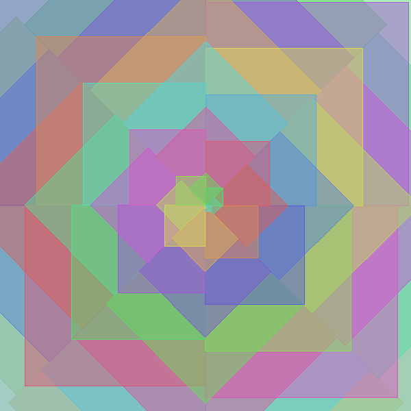

# Looping Pattern: Diamond Kaleidoscope

A spiraling kaleidoscope of squares. I was thinking about kaleidoscopes when I saw the option of the hls colors. I know kaleidoscopes move, so this is a nice start.



## How to run it

1. Install the libraries (one time only):
   ```
   pip install pillow seaborn
   ```
2. From Terminal:
   ```
   cd ~/Desktop/IxD/"Logic of Interaction"/week-4-homework
   python looping-diamond-kaleidoscope.py
   ```

A window opens showing the pattern, and the picture is also saved as `my-kaleidoscope.png`.

## How it works

`inc = pi*2/8` splits the full circle into 8 equal angles of 45°, so after 8 squares it adds up to 360° and starts over. That makes the squares stack up in the same 8 directions, which creates 8 legs.

`x` and `y` use `cos(theta)` and `sin(theta)` to place each square in a direction around the middle of the canvas, and `r` sets how far out it goes. Since `r` gets smaller as the squares shrink, each square moves closer to the middle, which makes the spiral.

Each square is tilted by `theta`. It rotates the square 45 degrees each time and makes the pattern look symmetrical.

`drawDiamond` finds 4 corners that are 90° apart and the same distance `h` from the square's center, then `polygon` connects them into a square. Adding `a` to each angle tilts the whole square.

`size = (count - j) * 12` makes each square smaller, going from 588 down to 12 pixels. The big squares are drawn first, so the small ones end up on top.

`rgb_palette[j % 20]` picks each square's color. When `j` gets past 19 it starts over at color 0, so the 20 colors repeat and the code never asks for a color that doesn't exist.

## Design choices

I started from my Fibonacci spiral code (`looping-pattern-fibonacci-spiral.py`) and changed:

- Circles → squares: to get more of the kaleidoscope effect. I tried taller, more diamond-like shapes but didn't like them as much, so I went back to even sides.
- 16 hls colors → 20: I liked how it looked better.
- Size step 10 → 12, so it runs off the edge: to fill the picture.

## Things I might try next

- Make it move like a real kaleidoscope

<!-- Optional: add more ideas you didn't get to -->

## Files

- `looping-diamond-kaleidoscope.py`: my final design
- `my-kaleidoscope.png`: the picture it makes
